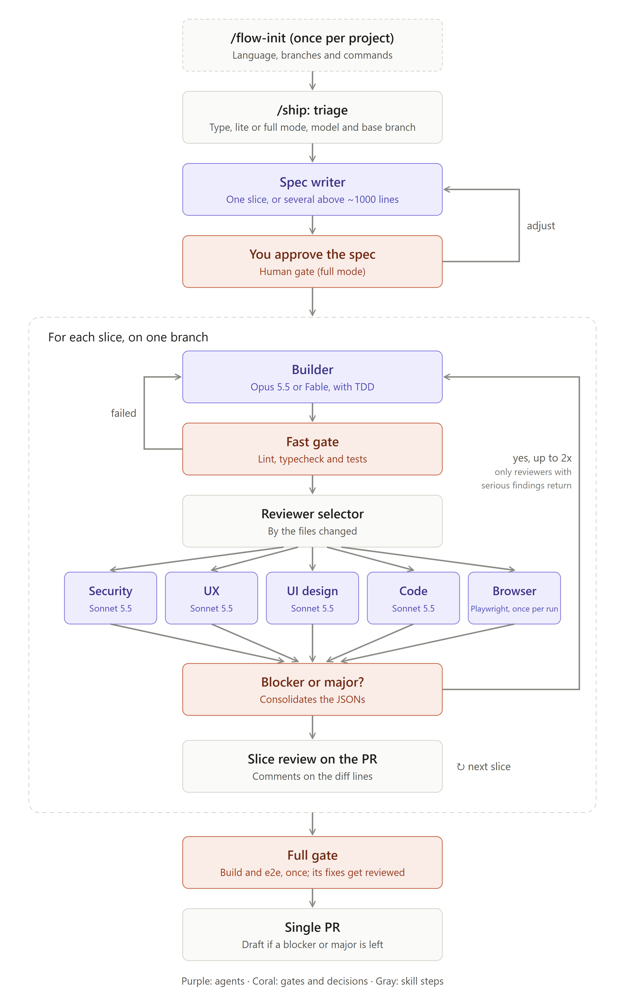

# flow

**English** · [Português](README.pt-BR.md)

A Claude Code plugin that takes a change from request to pull request. It triages the request, writes a spec split into slices, implements each slice with TDD, runs a quality gate, reviews the code with specialized agents in parallel, sends serious findings back to the builder for a capped number of rounds, and opens a PR with the findings posted as comments on the right lines. When a finding is fixed later, its thread gets a reply and is resolved.

It works in **English or Brazilian Portuguese**, and you choose the language per project.

This repository is both the plugin and the marketplace that distributes it.

## How it works

<p align="center">
  
</p>

```
/flow:ship "add PIX checkout"
   │
   ├─ triage ............ change type, lite or full mode, builder model, base branch
   ├─ spec-writer ....... one slice, unless the change is large (> ~1000 lines) or splits naturally
   ├─ human gate ........ you approve the spec (full mode only)
   ├─ for each slice, on one branch
   │    ├─ builder ...... TDD + conventional commits, running only the related tests
   │    ├─ fast gate .... lint, typecheck, tests
   │    ├─ reviewers .... chosen by the files changed, in parallel; later rounds re-call only who needs it
   │    ├─ fix loop ..... blocker/major (plus small minors), at most 2 rounds
   │    └─ publish ...... one PR for the run, one review per slice
   ├─ browser ........... once per run, on the last slice that touches the web frontend
   └─ full gate ......... build and e2e, once, before the PR leaves draft
```

By default the whole change goes into **one PR**, with the slices as groups of commits and one review per slice. For very large changes, `"prMode": "stacked"` (or `--stacked`) gives one PR per slice on an integration branch, plus a final PR to your base. A hotfix goes straight to `main`, and its back-merge PR is opened afterwards.

### Lite and full

| | Lite | Full |
| - | ---- | ---- |
| Spec | Short, one slice, Sonnet, no approval step | Sliced, Opus, approval step |
| Reviewers | `code`, plus `security` when routed | Every routed reviewer |
| Browser | Only with `--browser` | Once per run |
| Recommended for | bugfix, hotfix, chore, small changes | features, broad refactors |

At the end of a run, `/ship` shows how long each step took per slice, from the timings stored in `state.json`.

## Install

```bash
claude plugin marketplace add ArtToledo/flow-plugin
claude plugin install flow@flow-marketplace
```

For local development, run `claude --plugin-dir /path/to/flow-plugin`. After editing plugin files, run `/reload-plugins`.

## Requirements

- Claude Code CLI
- `git` and `gh`, authenticated with `gh auth login`
- Node.js 18 or later (the plugin scripts and the Playwright MCP server need it)

## Usage

| Command | What it does |
| ------- | ------------ |
| `/flow:flow-init` | Asks for the language, maps the project (branches, quality commands, stack, dev server) and writes `.claude/flow.json`. Run it once per project. |
| `/flow:ship <request>` | Runs the flow for one change. Flags: `--lite` / `--full` (skip the mode question), `--stacked` (one PR per slice), `--browser` (force the browser round), `--lighthouse` (measure Core Web Vitals on a production build). |
| `/flow:ship --resume <slug>` | Resumes an interrupted run. |
| `/flow:ship --recheck <slug> [NN]` | Re-reviews the findings still open on the PR (optionally letting the builder fix them first), replies "fixed in `<sha>`" and resolves the threads that were fixed. |
| `/flow:ship --restack <slug>` | Stacked mode: rebases the slices after one of them is merged. |
| `/flow:ship --finalize <slug>` | Opens the integration → base PR (stacked mode), or the back-merge PR for a hotfix. |

Run artifacts (spec, findings, state and screenshots) are stored in `.claude/flow-runs/<slug>/`. `/flow:flow-init` adds that folder to `.gitignore`.

## Language

The first thing `/flow:flow-init` asks is which language to use: **English** or **Português (Brasil)**. The answer is saved as `"language": "en"` or `"language": "pt-BR"` in `.claude/flow.json`.

That setting controls everything the flow writes for people:
- the questions it asks you;
- the spec;
- commit descriptions;
- PR titles and bodies;
- review findings and comments.

Code and identifiers keep your codebase's conventions. Conventional commit types and scopes stay as keywords, for example `feat(orders): add ownership check` or `feat(orders): adiciona checagem de dono`.

To switch languages later, edit `language` in `flow.json`. A run already in progress keeps the language it started with.

## Agents

| Agent | Model | Role |
| ----- | ----- | ---- |
| `flow:spec-writer` | Opus (Sonnet in lite mode) | Writes the spec as slices with testable acceptance criteria |
| `flow:builder` | Opus (or Fable, chosen at triage) | The only agent that writes code; uses TDD and conventional commits |
| `flow:code-reviewer` | Sonnet | Runs on every slice: tests, architecture, errors, concurrency, performance |
| `flow:security-reviewer` | Sonnet | OWASP Top 10:2025 and ASVS 5.0 |
| `flow:ux-reviewer` | Sonnet | Nielsen's heuristics and WCAG 2.2 AA behavior |
| `flow:ui-reviewer` | Sonnet | Design tokens, contrast, responsive layout, Core Web Vitals |
| `flow:browser-tester` | Sonnet | Tests the change in a real browser through Playwright MCP, once per run: acceptance criteria, console, network, 3 viewports, keyboard, axe-core, and Lighthouse with `--lighthouse` |

The reviewers can't edit code. Each one returns JSON in the format defined in [`skills/ship/reference/review-schema.json`](skills/ship/reference/review-schema.json).

- A round with a `blocker` or `major` goes back to the builder, for at most 2 rounds. Small `minor` findings ride along in the same fix; the rest are `deferred`.
- In later rounds only the reviewers that had a `blocker` or `major` are called again, the browser included; the others are carried forward by script.
- The builder's word is not proof. A finding it reports as fixed that no reviewer re-checked stays listed as *not re-checked* until `--recheck` confirms it.
- When the full gate (build, e2e) forces fixes, `code` (plus `security` when routed) reviews just those fixes. When it passes the first time, nothing extra runs.
- What is left becomes PR comments. Each thread carries a hidden marker, so `--recheck` can reply to it and resolve it once the finding is fixed.
- If a blocker or major is still open after the last round, the PR stays a draft, with the open findings listed at the top. A blocker also stops the run; a major doesn't.

## Design choices

- **The orchestration runs in the main session.** The human gates (triage and spec approval) need to talk to you, and that works reliably there.
- **Deterministic logic lives in scripts, not prompts.** Dependency-free Node scripts in [`scripts/`](scripts/), with unit tests, handle:
  - reviewer routing by glob;
  - review validation and deduplication;
  - inline-comment payloads (only on lines that are in the diff);
  - carrying reviewers forward between rounds;
  - finding, replying to and resolving the flow's PR threads;
  - step timings;
  - the dev server lifecycle;
  - the PR text in both languages.
- **The builder keeps its context between rounds.** It is resumed with `SendMessage` instead of being started from scratch, so it remembers why it wrote what it wrote.
- **No AI attribution** is added to commits, PRs or comments.

## Per-project customization

- `.claude/flow.json` holds the language, the PR mode (`"prMode": "single"` or `"stacked"`), the base branch for each change type, branch prefixes, quality commands, reviewer routing globs, dev server settings and loop limits.
- `.claude/checklists/<security|ux|ui|code>.md` extends the plugin's checklist. To replace it instead, start the file with `<!-- mode: replace -->`.

## Development

```bash
node --test scripts/test/*.test.mjs
claude plugin validate .
```

The full design is in [`PLAN.md`](PLAN.md) ([Portuguese version](PLAN.pt-BR.md)). The Phase 1 format checks are in [`docs/phase-1-verification.md`](docs/phase-1-verification.md).

## Status

All five phases and the language selection are implemented. The scripts, the plugin installation and the agent loading have been tested. The end-to-end acceptance run on a real feature is still pending.
