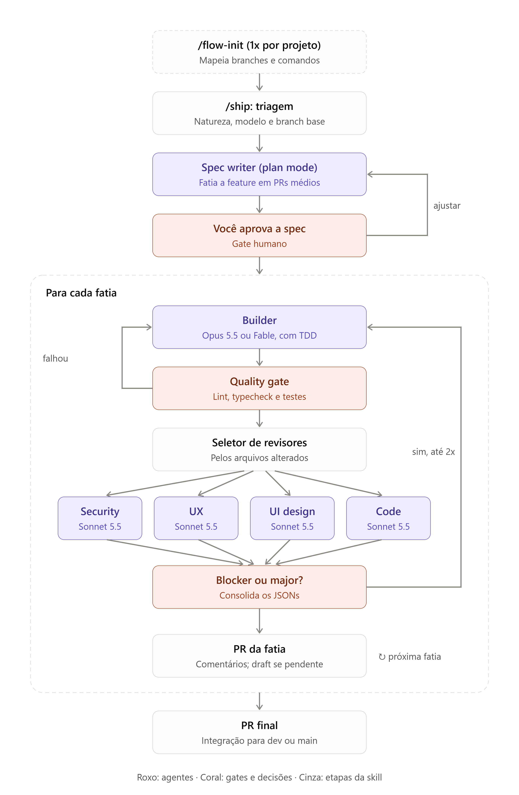

# flow

[English](README.md) · **Português**

Plugin do Claude Code que leva uma mudança do pedido ao pull request. Ele faz a triagem do pedido, escreve uma spec dividida em fatias e implementa cada fatia com TDD. Depois roda um quality gate e revisa o código com agentes especializados em paralelo. Achados graves voltam ao builder por um número limitado de rodadas, e no fim o plugin abre PRs empilhados com os achados comentados nas linhas certas.

Funciona em **inglês ou português (Brasil)**, e você escolhe o idioma por projeto.

Este repositório é, ao mesmo tempo, o plugin e o marketplace que o distribui.

## Como funciona

<p align="center">
  
</p>

```
/flow:ship "adicionar checkout com PIX"
   │
   ├─ triagem ........... natureza, modelo do builder, branch base
   ├─ spec-writer ....... spec fatiada (≈400 linhas de diff por fatia)
   ├─ gate humano ....... você aprova a spec ou pede ajustes
   └─ para cada fatia
        ├─ builder ...... TDD + conventional commits
        ├─ quality gate . lint, typecheck, testes, build, e2e (do seu projeto)
        ├─ revisores .... escolhidos pelos arquivos alterados, em paralelo
        ├─ loop ......... só achados blocker/major, no máximo 2 rodadas
        └─ pull request . comentários inline; draft se sobrar blocker
```

Uma feature grande vira uma série de PRs médios empilhados, todos apontando para uma branch de integração. Só a integração abre PR para a sua branch base. Um hotfix vai direto para a `main`, e o PR de back-merge é aberto depois.

## Instalação

```bash
claude plugin marketplace add ArtToledo/flow-plugin
claude plugin install flow@flow-marketplace
```

Para desenvolvimento local, use `claude --plugin-dir /caminho/para/flow-plugin`. Depois de editar arquivos do plugin, rode `/reload-plugins`.

## Requisitos

- Claude Code CLI
- `git` e `gh`, autenticado com `gh auth login`
- Node.js 18 ou superior, usado pelos scripts do plugin e pelo Playwright MCP

## Uso

| Comando | O que faz |
| ------- | --------- |
| `/flow:flow-init` | Pergunta o idioma, mapeia o projeto (branches, comandos de qualidade, stack, servidor de dev) e grava `.claude/flow.json`. Roda uma vez por projeto. |
| `/flow:ship <pedido>` | Executa o fluxo completo para uma mudança. |
| `/flow:ship --resume <slug>` | Retoma uma execução interrompida. |
| `/flow:ship --restack <slug>` | Faz rebase das fatias empilhadas depois que uma delas é mergeada. |
| `/flow:ship --finalize <slug>` | Abre o PR integração → base, ou o back-merge de um hotfix. |

Os artefatos de execução (spec, achados, estado e screenshots) ficam em `.claude/flow-runs/<slug>/`. O `/flow:flow-init` adiciona essa pasta ao `.gitignore`.

## Idioma

A primeira pergunta do `/flow:flow-init` é o idioma: **English** ou **Português (Brasil)**. A resposta fica gravada em `.claude/flow.json` como `"language": "en"` ou `"language": "pt-BR"`.

Essa configuração vale para tudo o que o fluxo escreve para pessoas:
- as perguntas que ele faz a você;
- a spec;
- a descrição dos commits;
- o título e a descrição dos PRs;
- os achados e os comentários dos revisores.

O código e os identificadores seguem as convenções do seu projeto. O tipo e o escopo dos conventional commits continuam como palavras-chave, por exemplo `feat(orders): adiciona checagem de dono`.

Para trocar de idioma depois, edite `language` no `flow.json`. Uma execução em andamento mantém o idioma com que começou.

## Agentes

| Agente | Modelo | Papel |
| ------ | ------ | ----- |
| `flow:spec-writer` | Opus | Spec fatiada com critérios de aceite testáveis |
| `flow:builder` | Opus (ou Fable, escolhido na triagem) | Único que escreve código; TDD e conventional commits |
| `flow:code-reviewer` | Sonnet | Roda em toda fatia: testes, arquitetura, erros, concorrência, performance |
| `flow:security-reviewer` | Sonnet | OWASP Top 10:2025 e ASVS 5.0 |
| `flow:ux-reviewer` | Sonnet | Heurísticas de Nielsen e comportamento WCAG 2.2 AA |
| `flow:ui-reviewer` | Sonnet | Tokens de design, contraste, responsividade, Core Web Vitals |
| `flow:browser-tester` | Sonnet | Testa a fatia num navegador real via Playwright MCP: critérios de aceite, console, rede, 3 larguras, teclado, axe-core, Lighthouse |

Os revisores não editam código, e cada um devolve JSON no formato de [`skills/ship/reference/review-schema.json`](skills/ship/reference/review-schema.json).

- Só achados `blocker` e `major` voltam ao builder, em no máximo 2 rodadas.
- Achados `minor` e `nit` viram comentários no PR.
- Se sobrar blocker depois da última rodada, o PR abre como draft, com os pendentes listados no topo.

## Decisões de design

- **A orquestração roda na sessão principal.** Os gates humanos (triagem e aprovação da spec) precisam conversar com você, e isso funciona de forma confiável ali.
- **Lógica determinística fica em scripts, não em prompts.** Scripts Node sem dependências, em [`scripts/`](scripts/) e com testes unitários, cuidam de:
  - roteamento de revisores por glob;
  - validação e deduplicação das reviews;
  - payload dos comentários inline (só em linhas que estão no diff);
  - ciclo de vida do servidor de dev;
  - texto dos PRs nos dois idiomas.
- **O builder mantém o contexto entre rodadas.** Ele é retomado com `SendMessage` em vez de começar do zero, e por isso lembra por que escreveu o que escreveu.
- **Sem atribuição a IA** em commits, PRs e comentários.

## Personalização por projeto

- `.claude/flow.json`: idioma, branch base de cada natureza, prefixos, comandos de qualidade, globs de roteamento, servidor de dev e limites do loop.
- `.claude/checklists/<security|ux|ui|code>.md`: estende o checklist do plugin. Para substituí-lo, comece o arquivo com `<!-- mode: replace -->`.

## Desenvolvimento

```bash
node --test scripts/test/*.test.mjs
claude plugin validate .
```

O desenho completo está em [`PLAN.pt-BR.md`](PLAN.pt-BR.md) ([versão em inglês](PLAN.md)). As verificações de formato da fase 1 estão em [`docs/phase-1-verification.md`](docs/phase-1-verification.md).

## Status

As cinco fases e a escolha de idioma estão implementadas. Os scripts, a instalação do plugin e o carregamento dos agentes foram testados. O teste de aceite de ponta a ponta numa feature real ainda está pendente.
